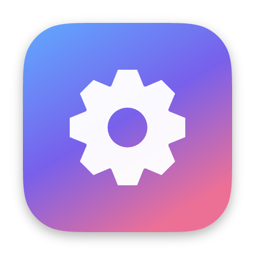
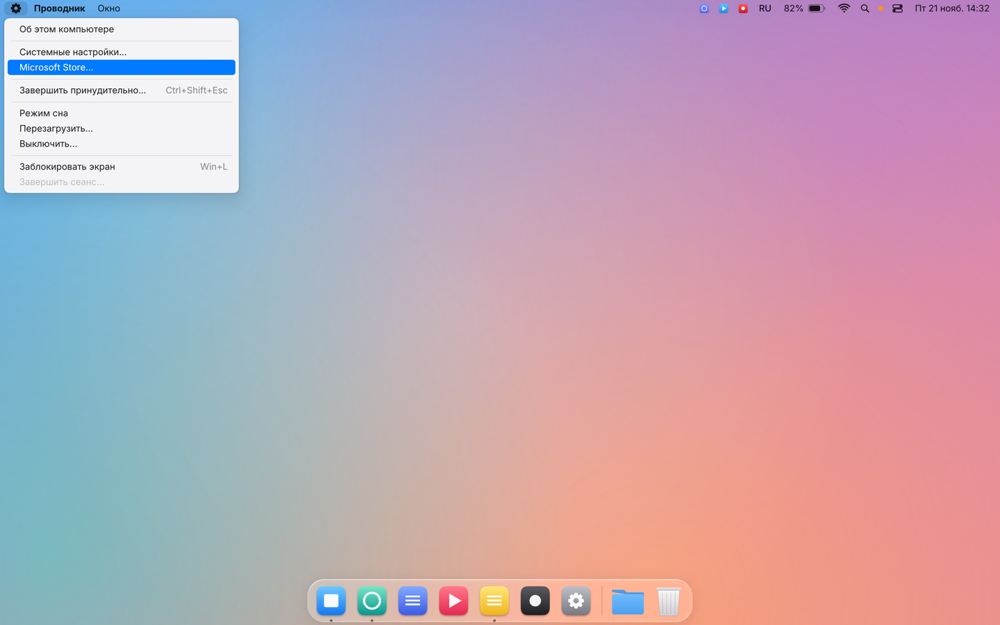
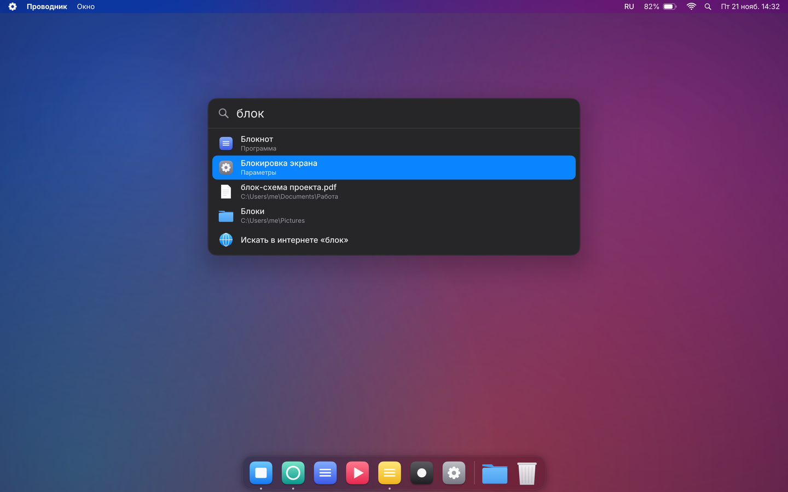

<p align="center"></p>

<h1 align="center">macRust</h1>

<p align="center">
  A macOS-style shell for Windows, written in Rust: a menu bar, a Dock with magnification and a search panel.<br>
  One 2.5 MB executable. No .NET, no Electron, no WebView.
</p>

<p align="center">
  <a href="https://github.com/trifonovsdev/macRust/actions/workflows/ci.yml"></a>
  
  
</p>

<p align="center">English | <a href="README.ru.md">Русский</a></p>



> [!WARNING]
> **Early preview.** v0.1.0 has not yet been tested on real hardware, so try it in a VM first.
> macRust hides the Windows taskbar while it runs and brings it back when it exits.
> The executable is not code-signed, so SmartScreen will warn you.

## Features

### Menu bar
- **Logo menu:** About This PC, System Settings, Microsoft Store and Force Quit (Task Manager). Also Sleep, Restart and Shut Down, each with a confirmation, plus Lock and Log Out.
- **Active app:** its name in bold, with a menu: Hide, Hide Others, Show All and Quit.
- **Window menu:** Minimize, Zoom, move to the left or right half of the screen (aligned to the visible frame, not the invisible resize border), Center and Bring All to Front.
- **Status items:** keyboard layout (click to switch), battery, network, search and a clock. Clicking the clock opens the notification center.
- **Translucent background:** the blurred, saturated wallpaper. Text turns dark or light depending on how bright the wallpaper is.
- **Menu switching:** while a menu is open, slide the cursor across the titles to switch menus, as on a Mac.

### Dock


- **What it shows:** pinned apps and every running app, plus Downloads and the Recycle Bin. Apps are grouped like the taskbar groups them, by AppUserModelID or by executable, so Store apps work too.
- **Magnification:** the point under the cursor stays put and the Dock grows on both sides of it.
- **Feedback:** the icon bounces while an app launches, a dot marks running apps, a label appears on hover and the icon darkens while pressed. Icons slide in and out when apps start and quit.
- **Click:** launches the app. If the app is active, its windows minimize. Otherwise all its windows come to the front.
- **Right-click:** the app's windows, Keep in Dock or Remove from Dock, Show in Explorer, New Window and Quit. The Recycle Bin also has Empty.

### Search (Alt+Space)


- **What it searches:** every app in `shell:AppsFolder` (Win32 and Store), Settings pages, and files and folders in Desktop, Documents, Downloads, Pictures, Music and Videos. Files are indexed in the background: up to 300k entries, refreshed every 30 minutes.
- **Fuzzy matching:** `vsc` finds Visual Studio Code, and Cyrillic matches without regard to case.
- **Calculator:** `2+2*2`, `(1,5+0,5)^3`. Press Enter to copy the result.
- **Web search:** the last row searches the web for the query.
- **Keys:** Enter opens the result and Ctrl+Enter shows it in Explorer. Esc clears the field, and a second Esc closes the panel. Ctrl+V, Ctrl+A, Ctrl+←/→ and Ctrl+Backspace work as usual.

> The screenshots come from the same rendering code (`cargo run -p macrust-ui --example preview`). The Dock icons in them are placeholders; on Windows the Dock shows real app icons.

## Install

1. Download `macrust.exe` from the [latest release](https://github.com/trifonovsdev/macRust/releases).
2. Run it. To start it at sign-in, run `macrust.exe --install` once.
3. To quit, open the logo menu in the menu bar and choose **Quit macRust**.

| Flag | What it does |
|---|---|
| `--install` | start at sign-in (HKCU Run key) and start now |
| `--uninstall` | remove from sign-in and bring the taskbar back |
| `--restore` | only bring the taskbar back |
| `--wallpaper` | set the bundled gradient as the desktop picture |

**The taskbar cannot get stuck hidden.** Its previous state is saved to
`%APPDATA%\macRust\taskbar-state.txt`. A tiny watchdog process
(`macrust.exe --watch <pid>`) restores it if the shell crashes or is ended from
Task Manager, and the next start restores it first too. To restore it by hand,
press Win+R and run `macrust.exe --restore`.

## Settings

The settings live in `%APPDATA%\macRust`. Restart macRust after editing them.

- `settings.txt`: `icon_size`, `magnified_size`, `magnification`, `hide_taskbar`, `reserve_dock_space`, `appearance` (`auto` | `light` | `dark`)
- `dock.txt`: pinned apps, one per line as `Name|exe|C:\path\to.exe` or `Name|aumid|AppUserModelID`. Pinning from the Dock's context menu is easier.
- `log.txt`: errors, because the shell has no console.

## Build

```powershell
# on Windows
cargo build --release -p macrust
```

```sh
# cross-compile from Linux (needs mingw-w64)
rustup target add x86_64-pc-windows-gnu
cargo build --release -p macrust --target x86_64-pc-windows-gnu
```

You can look at the UI on any OS:

```sh
cargo run --release -p macrust-ui --example preview -- out
cargo test -p macrust-ui
```

## How it works

```
crates/ui      rendering, animation and state of every component; no OS code
crates/shell   Windows host: layered windows, input, window tracking, shell icons, system
```

- **Windows:** each component is a layered window (`UpdateLayeredWindow`) with per-pixel alpha. Fully transparent pixels let clicks through, so the Dock's window can be wider than the Dock.
- **Rendering:** `tiny-skia` draws on the CPU with SIMD. Text is Inter, rasterized with `ab_glyph`, with a glyph cache and quarter-pixel horizontal positioning. Corners are continuous-curvature squircles rather than circular arcs.
- **Motion:** every animation is a spring, as in SwiftUI. An interrupted animation keeps its velocity instead of jumping.
- **Idle cost:** frames are drawn only while something moves, paced to the display with `DwmFlush`. At rest the process sleeps in `GetMessage`; the only timers are the clock and a one-second status tick.
- **Blur:** the menu bar and the Dock reserve their strips of the work area, so the desktop is always behind them. Their translucent material is the wallpaper blurred and saturated once per window, and frames just copy it. A live blur cost 6 ms per frame.
- **Shadows and icons:** shadows are pre-blurred nine-slice textures, and each icon's shadow is baked into the icon. Icons keep mip levels, so a 256 px icon drawn at 52 px stays sharp.
- **Window tracking:** WinEvent hooks report window changes instead of polling, and bursts of events collapse into one refresh.

Frame cost at 2x scale on a small cloud VM (a desktop CPU is faster):

| | ms per frame |
|---|---|
| Dock while magnifying (2236×304 px) | 5.0 |
| Search panel opening | 3.6 |
| Search results (8 rows) | 5.8 |
| Menu bar | 0.2 |

## Roadmap

- Dock auto-hide, dragging icons, minimize-to-Dock animation (via DWM thumbnails)
- Control Center, Notification Center, Mission Control, Launchpad
- App menus in the menu bar (Win32 apps expose them through `HMENU`)
- Multiple monitors (the menu bar and the Dock are on the primary one for now)
- CJK fallback fonts for file names

## License

MIT or Apache-2.0, at your option: see [LICENSE-MIT](LICENSE-MIT) and [LICENSE-APACHE](LICENSE-APACHE).
The bundled Inter typeface is licensed under the SIL Open Font License; see
[crates/ui/fonts/Inter-LICENSE.txt](crates/ui/fonts/Inter-LICENSE.txt).

Inspired by [WinRust](https://github.com/Lemxy/WinRust). Not affiliated with Apple; macOS is a trademark of Apple Inc.
