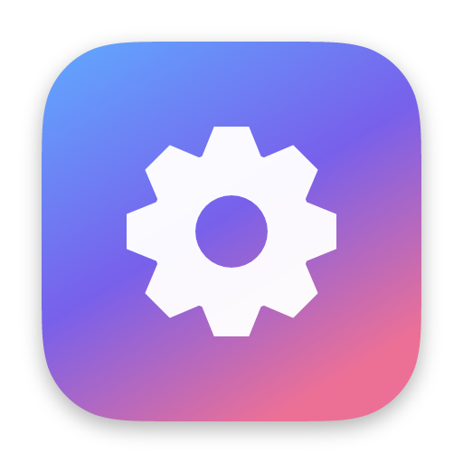
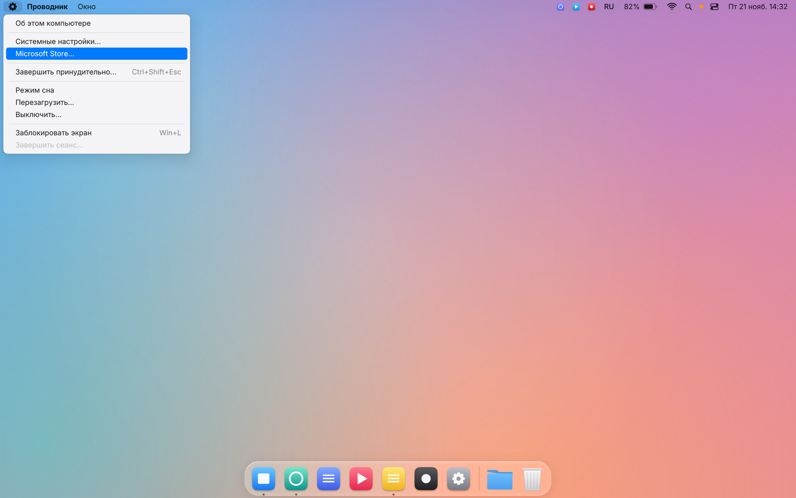
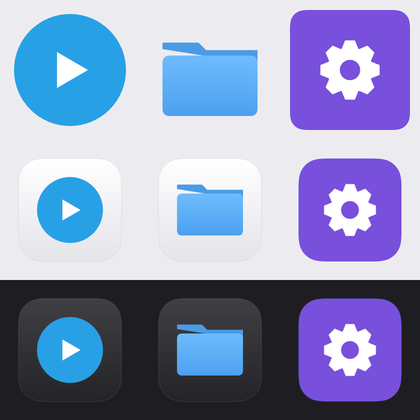
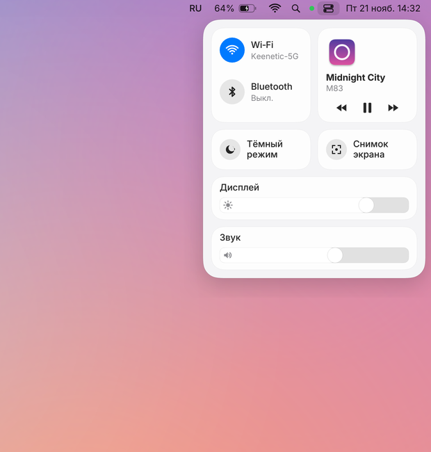
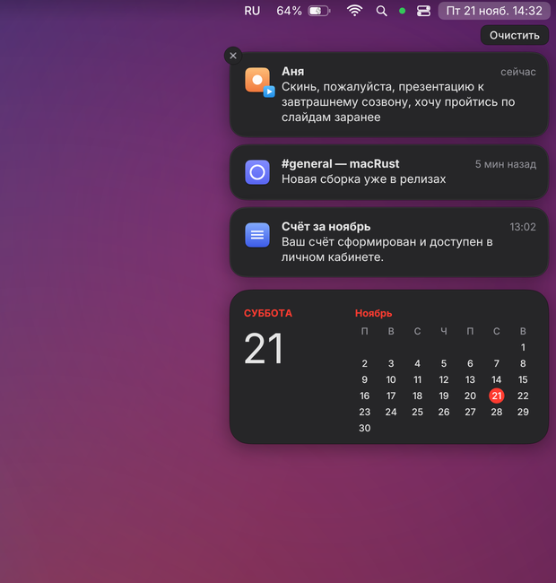
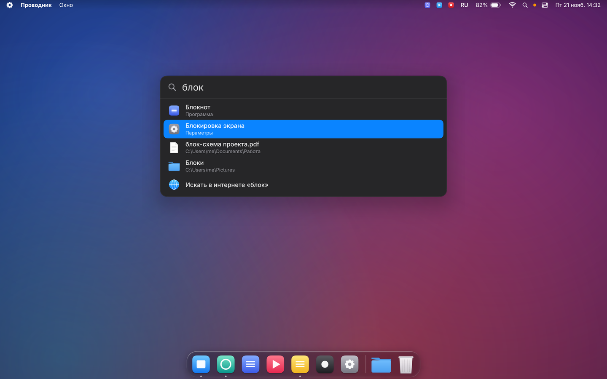

<p align="center"></p>

<h1 align="center">macRust</h1>

<p align="center">
  Оболочка Windows в духе macOS на Rust: строка меню с иконками трея, Dock из Liquid Glass,
  Пункт управления, Центр уведомлений и поиск.<br>
  Один небольшой exe, без .NET, Electron и WebView.
</p>

<p align="center"><a href="README.md">English</a> | Русский</p>



> [!WARNING]
> **Ранняя версия.** Ещё мало проверялась на живом железе — сначала попробуйте в виртуальной машине.
> Пока macRust работает, таскбар Windows скрыт; при выходе он возвращается.
> Exe не подписан, SmartScreen покажет предупреждение.

## Что есть

**Строка меню** (24 pt, сверху, резервирует место в рабочей области)
- Меню логотипа: «Об этом компьютере», «Системные настройки», Microsoft Store,
  «Завершить принудительно» (Диспетчер задач), сон, перезагрузка и выключение
  (с подтверждением), блокировка, выход из сеанса, «Завершить macRust».
- Имя активной программы жирным; меню «Скрыть», «Скрыть остальные», «Показать все»,
  «Завершить».
- Меню «Окно»: свернуть, развернуть, половина экрана слева/справа (точно по видимой
  рамке окна), по центру, все окна на передний план.
- Иконки трея: macRust сам принимает значки области уведомлений, поэтому значок
  записи OBS, счётчики непрочитанного Telegram и Discord и все остальные видны
  в строке меню в актуальном состоянии. Левый и правый клик доходят до программы,
  как на таскбаре.
- Справа: раскладка клавиатуры (клик переключает), батарея, сеть, поиск,
  Пункт управления и часы («Пт 21 нояб. 14:32»). Клик по часам открывает
  Центр уведомлений.
- Индикатор приватности: оранжевая точка, пока программа пишет с микрофона,
  зелёная — пока работает камера.
- Без фона, как в macOS 26: видны обои, цвет текста подбирается по их яркости.
- Когда меню открыто, проведи курсором по заголовкам — меню переключаются, как в macOS.

**Dock**


- Liquid Glass: прозрачная плита, которая преломляет обои у края и ловит блик,
  как в macOS 26.
- Форма иконок как в macOS 26: квадратные плитки обрезаются по сквирклу, круглые
  логотипы и иконки с прозрачностью лежат на плашке под светлую или тёмную тему.

  
- Закреплённые программы и все запущенные (группировка как у таскбара: по
  AppUserModelID или exe, включая Store-приложения), «Загрузки» и Корзина справа
  от разделителя. Программа, свёрнутая в трей (Telegram, Discord, OBS), остаётся
  в Dock с точкой, пока работает.
- Увеличение иконок: точка под курсором остаётся на месте, Dock растёт в обе стороны.
- Прыжки иконки при запуске, пока у программы не появится окно.
- Точки под запущенными, подписи над иконками, затемнение при нажатии,
  плавное появление и исчезновение иконок.
- Клик: запуск или вывод окон программы вперёд. Клик никогда не сворачивает
  программу; если все её окна свёрнуты, одно разворачивается. Программу из трея
  клик просит показать окно.
- Правый клик: список окон программы, «Оставить в Dock» / «Удалить из Dock»,
  «Показать в Проводнике», «Новое окно», «Завершить»; у Корзины — «Очистить».

**Пункт управления**



- Wi‑Fi и Bluetooth с названием сети; клик по названию открывает настройки.
- «Сейчас играет» для любой программы, которая сообщает Windows о медиа (Spotify,
  браузеры, плееры): обложка, название, исполнитель, назад, пауза, вперёд.
- «Тёмный режим» переключает тему самой Windows. «Снимок экрана» открывает
  «Ножницы».
- Ползунки яркости (внешние мониторы по DDC/CI) и громкости; клик по динамику
  выключает звук.

**Центр уведомлений**



- Уведомления всех программ (Telegram, Discord, почта…) из истории уведомлений
  Windows, с иконками программ и аватарками отправителей. Клик открывает программу,
  при наведении появляется крестик, есть «Очистить».
- Виджет календаря с сегодняшней датой.
- Новые уведомления выезжают баннером справа сверху и скрываются через пять секунд,
  если на них не навести курсор. Windows при этом показывает и свои всплывающие
  уведомления; включите в Windows «Не беспокоить», чтобы остались только баннеры
  macRust (история уведомлений при этом сохраняется).

**Поиск** (Alt+Space или лупа в строке меню)



- Все программы из `shell:AppsFolder` (обычные и из Store), разделы Параметров,
  файлы и папки из «Рабочего стола», «Документов», «Загрузок», «Изображений», «Музыки»,
  «Видео» (индексируются в фоне, до 300 тыс. записей, обновление раз в 30 минут).
- Нечёткий поиск: «vsc» находит Visual Studio Code; кириллица без учёта регистра.
- Калькулятор: `2+2*2`, `(1,5+0,5)^3`; Enter копирует результат.
- Последняя строка — поиск в интернете.
- Enter — открыть, Ctrl+Enter — показать в Проводнике, Esc — очистить поле, второй
  Esc — закрыть. Ctrl+V, Ctrl+A, Ctrl+←/→, Ctrl+Backspace.

**Обычный таскбар** скрывается (и включается автоскрытие, чтобы он не занимал место).
При выходе из macRust он возвращается.

## Установка

Нужна Windows 10 или 11 (x64). Скачайте `macrust.exe` из
[последнего релиза](https://github.com/trifonovsdev/macRust/releases) и запустите.

Сборка на Windows:

```powershell
cargo build --release -p macrust
```

Сборка из Linux (кросс-компиляция):

```sh
rustup target add x86_64-pc-windows-gnu   # и пакет mingw-w64
cargo build --release -p macrust --target x86_64-pc-windows-gnu
# -> target/x86_64-pc-windows-gnu/release/macrust.exe
```

Ключи командной строки:

| Ключ | Что делает |
|---|---|
| `--install` | запускать macRust при входе в Windows (HKCU\…\Run) и запустить сейчас |
| `--uninstall` | убрать из автозапуска и вернуть таскбар |
| `--restore` | только вернуть таскбар (если что-то пошло не так) |
| `--wallpaper` | поставить на рабочий стол встроенные градиентные обои |

Выход: логотип в строке меню → «Завершить macRust».

**Таскбар не останется скрытым.** Прежнее состояние хранится в
`%APPDATA%\macRust\taskbar-state.txt`. Вместе с оболочкой запускается крошечный
сторожевой процесс (`macrust.exe --watch <pid>`): если оболочка упала или её убили
через Диспетчер задач, он возвращает таскбар. Следующий запуск тоже сначала
восстанавливает его. Вручную: Win+R → `macrust.exe --restore`.

## Настройки

Файлы в `%APPDATA%\macRust` (после правки перезапустите macRust):

- `settings.txt`: `icon_size`, `magnified_size`, `magnification`, `hide_taskbar`,
  `reserve_dock_space`, `appearance` (`auto` | `light` | `dark`), `tray_icons`
  (иконки трея в строке меню), `banners` (баннеры уведомлений).
- `dock.txt`: закреплённые программы, по строке `Имя|exe|C:\путь\к.exe` или
  `Имя|aumid|AppUserModelID`. Удобнее закреплять через правый клик в Dock.
- `log.txt`: ошибки (у оболочки нет консоли).

## Как устроено и почему быстро

```
crates/ui      отрисовка, анимации и состояние компонентов; не зависит от ОС
crates/shell   Windows: слоистые окна, ввод, трекинг окон, иконки, система
```

- Каждый компонент — слоистое окно (`UpdateLayeredWindow`) с попиксельной альфой.
  Прозрачные пиксели пропускают клики, поэтому окно Dock может быть шире самого Dock.
- Отрисовка — `tiny-skia` (CPU, SIMD), текст — шрифт Inter (OFL) через `ab_glyph`
  с кешем глифов и субпиксельным позиционированием по горизонтали. Скругления —
  «непрерывные» (squircle), как в macOS, а не дуги окружности.
- Все движения — пружины (как в SwiftUI): при прерывании анимация продолжается
  с текущей скоростью, без рывков.
- Кадры идут только во время анимации и синхронизируются с монитором через
  `DwmFlush`. В покое процесс спит в `GetMessage` и не тратит CPU: раз в секунду
  проверяются раскладка и батарея, раз в минуту обновляются часы.
- Стекло Dock преломляет слегка размытую копию обоев (строка меню и Dock
  резервируют свою полосу экрана, так что под ними всегда обои). Изгиб и блик
  кромки считаются по полю расстояний скруглённого прямоугольника, попиксельно —
  только кромка, середина копируется из кеша.
- Трей: скрытое окно класса `Shell_TrayWnd` стоит выше окна Проводника, поэтому
  вызовы `Shell_NotifyIcon` сначала приходят в macRust; каждый пересылается и
  Проводнику, так что после выхода из macRust всё на месте.
- Уведомления читаются из пользовательской базы уведомлений Windows; «Сейчас
  играет», громкость, радиомодули и яркость — через WinRT и Core Audio в фоновом
  потоке.
- Тени — заранее размытые nine-slice текстуры; тень иконки запечена в саму иконку;
  у иконок есть mip-уровни, чтобы 256 px иконка в 52 px была чёткой.
- Окна отслеживаются хуками WinEvent, а не опросом. Пачки событий схлопываются
  в одно обновление.

Замеры одного кадра при масштабе 2x на слабом облачном CPU (на настольном быстрее):
Dock с увеличением 6,2 мс (окно 2236×304), открытие поиска 3,6 мс,
список из 8 результатов 5,8 мс, строка меню 0,2 мс.

Посмотреть интерфейс без Windows:

```sh
cargo run --release -p macrust-ui --example preview -- out
cargo test -p macrust-ui
```

## Чего пока нет

- Файловый менеджер в стиле Finder.
- Автоскрытие Dock, перетаскивание иконок, свёрнутые окна в Dock
  (через DWM-миниатюры).
- Mission Control, Launchpad.
- Меню самих программ в строке меню (у Win32-программ его можно прочитать
  через `HMENU`).
- Несколько мониторов: строка меню и Dock только на основном.
- Иероглифы в именах файлов: резервные шрифты сейчас Segoe UI и Segoe UI Symbol.

## Лицензия

MIT или Apache-2.0 на выбор: [LICENSE-MIT](LICENSE-MIT), [LICENSE-APACHE](LICENSE-APACHE).
Шрифт Inter распространяется по SIL Open Font License, текст лицензии —
в [crates/ui/fonts/Inter-LICENSE.txt](crates/ui/fonts/Inter-LICENSE.txt).

Вдохновлено [WinRust](https://github.com/Lemxy/WinRust). Проект не связан с Apple; macOS — товарный знак Apple Inc.
